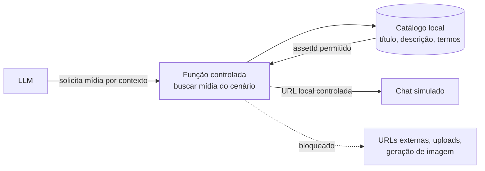
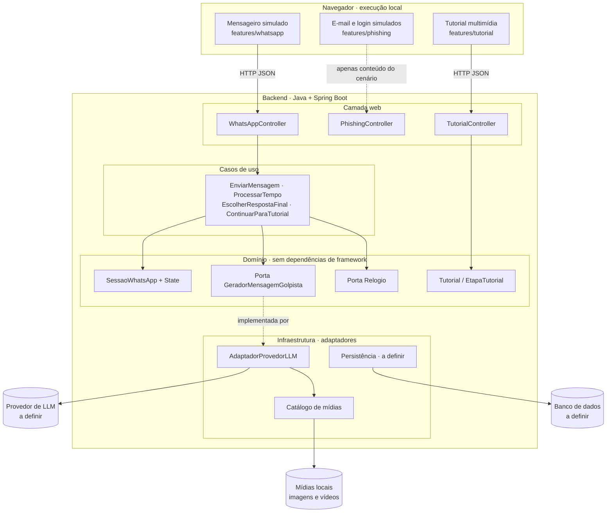
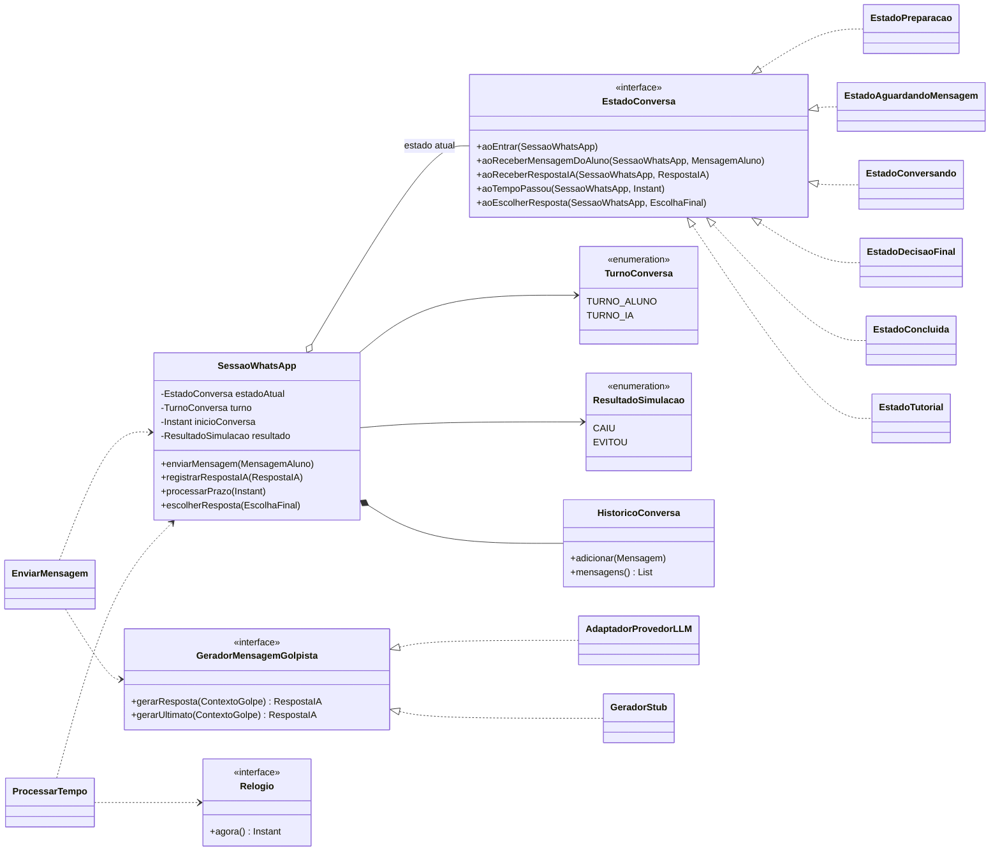
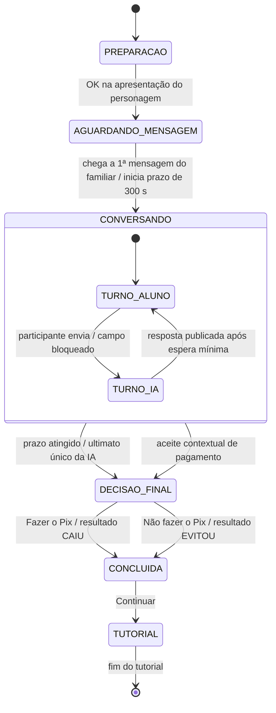
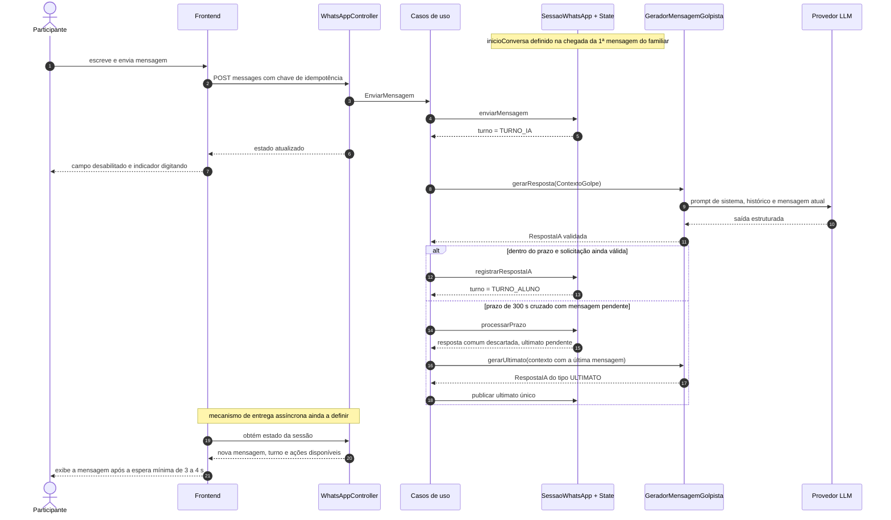
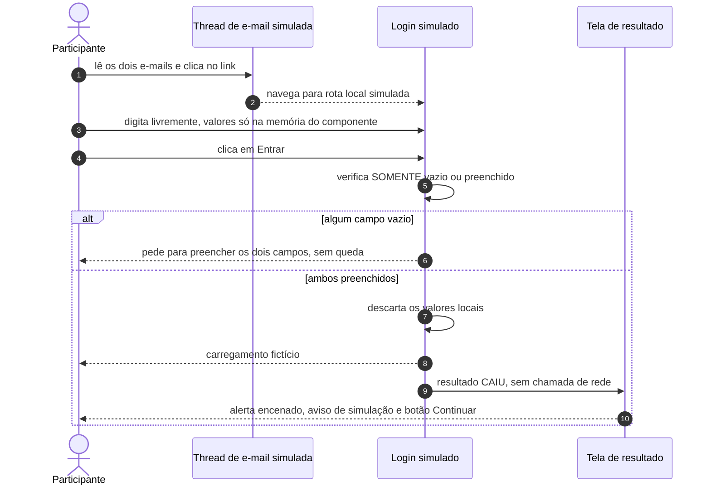
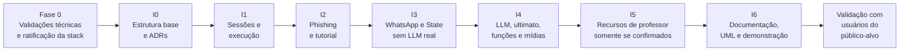
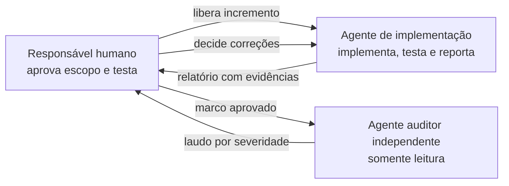

# Golpe NUNCA+ (Golpe Nunca Mais)

**Plataforma didática de simulação de golpes digitais para pessoas com baixo letramento digital.**


> [!IMPORTANT]
> **Este repositório documenta um projeto planejado, ainda não implementado.**
> Não há código-fonte, testes executados, métricas, integrações ativas nem resultados com usuários.
> Tudo o que está descrito abaixo como funcionalidade, arquitetura ou teste é **intenção de projeto**. Parte dessas decisões ainda precisa ser validada antes de iniciar o desenvolvimento (ver [Estado atual](#8-estado-atual)).

<p align="center">
  
  <br>
  <sub><em>Mockup conceitual da tela inicial. Imagem ilustrativa de direção visual, <strong>não é captura de tela de uma aplicação existente</strong>.</em></sub>
</p>

---

## Sumário

1. [Visão geral](#1-visão-geral)
2. [Funcionalidades planejadas](#2-funcionalidades-planejadas)
3. [Inteligência artificial](#3-inteligência-artificial)
4. [Arquitetura proposta](#4-arquitetura-proposta)
5. [Fluxo de uma simulação](#5-fluxo-de-uma-simulação)
6. [Desafios e validações pendentes](#6-desafios-e-validações-pendentes)
7. [Roadmap](#7-roadmap)
8. [Estado atual](#8-estado-atual)
- [Competências de engenharia demonstradas no projeto](#competências-de-engenharia-demonstradas-no-projeto)
- [Avisos](#avisos)

### Como ler as decisões deste documento

A especificação de origem (documento mestre do projeto, v3.1) classifica cada decisão por grau de maturidade. Este README mantém a mesma classificação para não apresentar hipóteses como fatos:

| Rótulo | Significado |
|---|---|
| `CONFIRMADO` | Decisão explícita do responsável pelo projeto; é requisito. |
| `PROPOSTO` | Detalhamento técnico sugerido, ainda sem aprovação formal. |
| `EM ABERTO` | Ponto não resolvido; precisa de definição antes do incremento afetado. |
| `INFERIDO` | Interpretação recomendada que ainda não foi aprovada literalmente. |

---

## 1. Visão geral

### O problema

Golpes digitais exploram menos falhas técnicas e mais **comportamento humano**: urgência, confiança em pessoas próximas e familiaridade com interfaces conhecidas. Dois padrões são especialmente comuns no Brasil:

- **Golpe do falso familiar:** alguém se passa por parente em um aplicativo de mensagens, inventa uma emergência e pede uma transferência via Pix.
- **Phishing:** um e-mail com aparência institucional leva a uma página falsa de login para capturar usuário e senha.

Materiais de conscientização costumam ser textos e listas de dicas. Para quem tem pouca familiaridade com tecnologia, ler sobre o golpe é muito diferente de **reconhecê-lo no momento em que acontece**.

### Público-alvo `CONFIRMADO`

A persona primária é uma pessoa de **aproximadamente 60 anos, com baixo letramento digital** e pouca familiaridade com golpes ou plataformas simuladas. O projeto parte de alguns pressupostos:

- não supor que a pessoa saiba o que é Pix, URL, domínio ou autenticação;
- evitar jargão como "credencial", "autenticação" ou "phishing" sem explicação;
- usar texto simples, áreas de toque grandes, hierarquia visual clara e conteúdo em passos.

### Objetivo educacional

Permitir que a pessoa **vivencie um golpe em ambiente seguro**, tome decisões como faria na vida real, sofra **consequências apenas simuladas** e, em seguida, aprenda a identificar os sinais de fraude e a reagir.

O objetivo **não** é capturar dados, constranger participantes ou causar qualquer dano real. Essa restrição vale como princípio de projeto para todas as decisões técnicas.

### Escopo do MVP `CONFIRMADO`

- Aplicação **executada localmente**, a partir do diretório do projeto, por **uma pessoa por vez**.
- Sem contas, tokens de acesso, salas ou perfil de professor. Esses recursos ficam para uma possível evolução futura (`EM ABERTO`).
- Uso de LLM quando disponível.
- Complexidade proporcional a uma **demonstração de potencial**: sem infraestrutura, controles ou tratamento de casos extremos desnecessários, mas **mantendo as proteções contra coleta de dados reais**.

---

## 2. Funcionalidades planejadas

> Nenhuma das funcionalidades abaixo existe. Esta seção descreve o comportamento especificado.

### 2.1 Cenário 1: falso familiar em mensageiro inspirado no WhatsApp

| Funcionalidade | Comportamento especificado | Maturidade |
|---|---|---|
| Apresentação do personagem | Antes da conversa, a pessoa vê a foto de um **irmão fictício** e uma explicação simples de que ele é seu familiar. Um botão "OK" confirma. | `CONFIRMADO` |
| Lista de conversas | Interface reconhecível de mensageiro com vários contatos e históricos fictícios para ambientação. **Só a conversa do familiar é acessível.** | `CONFIRMADO` |
| Chegada da mensagem | Cerca de 2 s após o "OK", chega uma mensagem do familiar, com som quando o navegador permitir. Exemplo: *"E aí, caçula, tudo bem? Como você tá?"* | `CONFIRMADO` |
| Conversa por turnos com IA | Uma mensagem livre do participante, uma resposta da IA, alternadamente. Durante o turno da IA o campo fica **acinzentado e desabilitado** e aparece o indicador de "digitando" (três pontos). | `CONFIRMADO` |
| Ritmo realista | A resposta só aparece após **no mínimo ~3–4 s**, mesmo que o modelo responda antes. Se a geração demorar mais, a interface continua esperando. | `CONFIRMADO` |
| Enredo do golpe | O falso irmão diz ter sofrido um acidente de carro e precisar de dinheiro para o guincho. Responde ao que a pessoa escreve, mas sempre volta ao pedido. Varia os argumentos mesmo diante de desconfiança. | `CONFIRMADO` |
| Fotos como "prova" | A IA pode enviar imagens **pré-geradas e autorizadas** do personagem, escolhidas por *function calling* em um catálogo local. O objetivo pedagógico é mostrar que fotos também podem ser manipuladas. | `CONFIRMADO` |
| Prazo de 5 minutos | O relógio começa quando chega a **primeira mensagem do familiar**. Ao fim do prazo, a IA envia **um único ultimato** que considera a última mensagem do participante. | `CONFIRMADO` |
| Aceite antecipado | Se, antes do prazo, a pessoa concordar em pagar (por exemplo, "pode mandar o Pix"), a conversa livre termina e as opções finais aparecem. **O aceite verbal não conta como queda.** | `CONFIRMADO` (comportamento) / `EM ABERTO` (técnica de detecção) |
| Decisão final | Duas respostas rápidas **dentro do chat**, sem modal e sem timer: **"Fazer o Pix"** e **"Não fazer o Pix"**. O campo de texto continua visível, porém desabilitado. | `CONFIRMADO` |
| Desfechos | "Fazer o Pix" mostra uma transferência fictícia e depois uma tela de risco (**CAIU**). "Não fazer o Pix" leva a uma tela positiva de prevenção (**EVITOU**). Os dois caminhos levam ao tutorial pelo botão "Continuar". | `CONFIRMADO` |

### 2.2 Cenário 2: phishing por e-mail e página institucional simulada

| Funcionalidade | Comportamento especificado | Maturidade |
|---|---|---|
| Thread de e-mail | **Dois e-mails encadeados** na mesma thread, em tela rolável, com pistas de fraude perceptíveis para quem observa com atenção. | `CONFIRMADO` |
| Exploração guiada | O fluxo conduz a pessoa a clicar no link. Não há pergunta explícita do tipo "cair ou ignorar". | `CONFIRMADO` |
| Pistas didáticas | Domínio aproximado, urgência, saudação genérica, erros formais e inconsistências visuais, **sem endereços reais**. | `PROPOSTO` |
| Página de login simulada | Página que lembra o ambiente virtual de aprendizagem de uma universidade, com anomalias sutis. A digitação nos campos é livre. | `CONFIRMADO` |
| Regra de queda | Clicar em **Entrar com os dois campos preenchidos** caracteriza a queda. Com algum campo vazio, aparece apenas uma validação local e **não** há queda. | `CONFIRMADO` |
| Encenação do impacto | Carregamento curto, tela impactante de "conta perdida" **como encenação** e, logo depois, aviso explícito de que **nenhuma conta real foi acessada e nada foi coletado**. | `CONFIRMADO` / `PROPOSTO` (aviso) |
| Desistência ou retorno | O que acontece se a pessoa sair, recarregar ou voltar sem enviar. | `INFERIDO` / `EM ABERTO` |

### 2.3 Feedback educativo e tutorial multimídia

- **Feedback imediato** `CONFIRMADO`: quem cai recebe um aviso claro e a explicação de por que a decisão foi arriscada; quem evita recebe reconhecimento e dicas práticas.
- **Tutorial em etapas** `CONFIRMADO`: reaproveitável nos dois cenários, navegação livre com **Anterior/Próximo**, número de etapas definido pela necessidade pedagógica, imagens e **vídeos curtos próprios** (com arquitetura preparada para links externos). **Vídeos nunca bloqueiam o avanço.**
- **Roteiros sugeridos** `PROPOSTO`:
  - *Falso familiar:* o que aconteceu → por que alguém se passou por familiar → sinais de urgência e pressão → conferir a identidade por outro canal → reconhecer um pedido de Pix → o que fazer antes de transferir → o que fazer se já transferiu → resumo.
  - *Phishing:* o que aconteceu → sinais no remetente → texto e urgência → verificar o link sem clicar → endereço e HTTPS não provam legitimidade → nunca entregar senha em link suspeito → acessar pelo endereço oficial → o que fazer se compartilhou a senha → revisão.

### 2.4 Acompanhamento dos resultados

| Item | Situação |
|---|---|
| Desfecho por sessão (`CAIU` / `EVITOU`), decidido pelo sistema e imutável após a escolha | `CONFIRMADO` |
| Persistência desse desfecho | `EM ABERTO` (o banco do MVP não foi definido) |
| Painel de professor, salas, métricas agregadas e exportação CSV | `EM ABERTO`: aparecem em planos anteriores, mas **não foram ratificados**; não fazem parte do MVP |
| Telemetria de phishing | `PROPOSTO`: no máximo um evento genérico de desfecho, sem identificação pessoal e somente se aprovado |

### 2.5 Acessibilidade

- `CONFIRMADO`: controle **"Aa"** para o tamanho do texto, interface minimalista inspirada em produtos financeiros de navegação simples e um **mascote** (pintinho amarelo) associado à prevenção.
- `PROPOSTO`: texto-base de pelo menos 16 px, foco visível, navegação por teclado, legendas nos vídeos, texto alternativo nas imagens, resultado que não dependa só de cor e suporte a redução de movimento.

---

## 3. Inteligência artificial

### 3.1 Papel da LLM: o que ela faz e o que não faz

O desenho separa **geração de linguagem** (papel da LLM) de **regras de negócio** (papel do domínio). Essa é a principal decisão de arquitetura do componente de IA.

| A LLM **pode** | A LLM **não pode** |
|---|---|
| Interpretar o personagem do falso familiar e responder ao que o participante escreveu | Decidir o desfecho (`CAIU`/`EVITOU`): ele é determinístico e definido pelo clique |
| Adaptar argumentos à desconfiança, a mudanças de assunto e a perguntas | Controlar o prazo de 5 minutos: o relógio é regra do sistema |
| Gerar **um único ultimato** contextualizado ao fim do prazo | Efetuar ou simular Pix, abrir bancos ou chamar serviços externos |
| Pedir, via *function calling*, uma imagem do **catálogo local pré-aprovado** | Gerar imagens em tempo real ou indicar URLs externas |
| — | Receber qualquer dado digitado no cenário de phishing |

### 3.2 Geração de conversa contextualizada `PROPOSTO`

Cada chamada ao modelo seria montada a partir de um objeto de domínio `ContextoGolpe`:

```text
ContextoGolpe
├── personagem            # persona do irmão fictício e tom da conversa
├── objetivo              # objetivo do golpista dentro do exercício
├── limitesDeSeguranca    # instruções de uso exclusivamente educacional
├── resumoDoHistorico     # histórico necessário, com retenção mínima
├── mensagemAtual         # última mensagem do participante
└── deadlineAtingida      # se verdadeiro, gerar ultimato em vez de resposta comum
```

- **Isolamento do prompt de sistema:** as regras do cenário ficam separadas das entradas do participante, e a mensagem do participante nunca substitui regras do sistema.
- **Saída estruturada e validável:** o adaptador devolve `RespostaIA { idSolicitacao, texto, tipo, metadadosTecnicos }`, com `tipo ∈ { MENSAGEM_COMUM, ULTIMATO }`. O estado da simulação **não é inferido do texto livre** do modelo.
- **Validação defensiva:** um parser confere presença de texto, tamanho e tipo antes de a resposta chegar ao domínio.

### 3.3 Function calling e catálogo de mídias



As imagens são preparadas antes pelo desenvolvedor, a partir de material autorizado, e descritas com título, descrição visual e termos associados. O modelo só pode **selecionar** entre `assetId`s vinculados ao cenário. O servidor resolve o arquivo local e devolve uma URL controlada `CONFIRMADO`/`PROPOSTO`.

### 3.4 Limites de segurança

- A chave de API fica **somente no backend**, fora do Git e fora do cliente `PROPOSTO`.
- Nenhuma transação real, nenhum aplicativo bancário e nenhuma integração com serviços reais `CONFIRMADO`.
- Diálogos completos não são armazenados por padrão, e os logs são sanitizados `PROPOSTO`.
- Por ser um MVP local e de usuário único, **prevenção avançada de prompt injection, circuit breakers e filas estão explicitamente fora de escopo** `CONFIRMADO`. As proteções básicas permanecem.
- **Falha ou demora do provedor** `CONFIRMADO`: encerrar a espera, mostrar aviso curto, permitir **uma** nova tentativa por ação do usuário ou reiniciar a simulação. Uma resposta atrasada de uma tentativa cancelada nunca deve aparecer.

---

## 4. Arquitetura proposta

### 4.1 Tecnologias e grau de definição

| Camada | Tecnologia | Situação |
|---|---|---|
| Backend | **Java + Spring Boot** | `CONFIRMADO` como preferência |
| Frontend | React + TypeScript | `PROPOSTO`: previsto em artefatos anteriores, **requer ratificação** |
| Banco de dados | PostgreSQL | `PROPOSTO`: **a necessidade de banco no MVP está em aberto** |
| Contêineres | Docker | `EM ABERTO` |
| Provedor de LLM | — | `EM ABERTO`: nenhum provedor ou modelo foi escolhido |
| Ambiente de desenvolvimento | Windows 11 com WSL2 (paridade com Linux) | `CONFIRMADO` |

### 4.2 Visão de componentes

Camadas `PROPOSTO`: **web/controller → application/use case → domain → infrastructure/adapters**, com frontend isolado. O **domínio não depende** de Spring, JPA, React, HTTP nem de SDK de provedor de IA.



> **Decisão-chave de privacidade:** no fluxo de phishing, a verificação "vazio/preenchido" acontece **só no navegador**. **Não existe endpoint de login** e nenhum valor digitado é transmitido, persistido ou registrado em log.

### 4.3 Responsabilidades `PROPOSTO`

| Componente | Responsabilidade | Não deve |
|---|---|---|
| `WhatsAppController` | Receber e validar HTTP, mapear DTOs | Conhecer prompts ou a máquina de estados |
| `PhishingController` | Entregar o conteúdo do cenário (thread, pistas) | Receber usuário ou senha |
| Casos de uso | Coordenar domínio e I/O com a LLM | Conter regras de transição |
| `SessaoWhatsApp` | Contexto do padrão State e guardião das invariantes | Fazer chamadas de rede |
| `EstadoConversa` e implementações | Validar ações e decidir transições | Formatar telas |
| `GeradorMensagemGolpista` | Porta para geração de texto, substituível por *stub* em testes | Decidir resultado ou prazo |
| `AdaptadorProvedorLLM` | Traduzir o SDK do provedor para a porta do domínio | Vazar tipos do provedor para o domínio ou o frontend |
| `Tutorial` / `EtapaTutorial` / `MidiaTutorial` | Modelar o conteúdo independentemente da tela | Misturar regras de fraude com apresentação |

### 4.4 Modelagem orientada a objetos: padrão State `PROPOSTO`

O núcleo acadêmico do projeto é a **máquina de estados da conversa**, implementada com o padrão **State** para substituir condicionais espalhadas. O turno usa um **enum** (`TURNO_ALUNO` / `TURNO_IA`) em vez de booleano `CONFIRMADO`.



**Invariantes de domínio** que o projeto pretende garantir e cobrir com testes:

- uma sessão tem exatamente **um estado ativo**;
- durante `TURNO_IA`, nenhuma nova mensagem do participante é aceita;
- `inicioConversa` é definido **uma única vez**, quando chega a primeira mensagem do familiar;
- nunca há **duas respostas** publicadas para o mesmo envio;
- o **ultimato é único** por sessão;
- nenhum *callback* tardio da LLM faz `CONCLUIDA`/`TUTORIAL` voltar para `CONVERSANDO`;
- a decisão final é **imutável** após o primeiro clique válido e **não aciona a LLM**.

**Princípios aplicados ao desenho:** SRP (controllers não calculam golpes; estados não formatam telas), OCP (novos estados sem reescrever condicionais), LSP (contratos de evento consistentes entre estados), ISP (dividir a interface State se ela acumular métodos sem sentido), DIP (domínio depende da porta, não do SDK), GRASP Controller e Information Expert. Os padrões Strategy, Adapter, Factory, Repository e Observer são considerados **somente se houver necessidade concreta**. O desenho evita intencionalmente *God Controller*, State superficial com `switch` gigante e "complexidade acidental para parecer avançado".

### 4.5 Fluxo de dados e privacidade `PROPOSTO`

| Dado | Pode existir? | Persistência | Observação |
|---|---|---|---|
| Texto digitado no login simulado | Só na memória do componente do navegador | **Proibida** | Sem transmissão, inspeção semântica, storage, cookies ou `console.log` |
| Indicador "campo preenchido" | Sim, no instante do clique | Preferencialmente não | Booleano efêmero |
| Mensagens da conversa simulada | Necessárias para o contexto da LLM | Política `EM ABERTO` | Evitar dados pessoais e retenção desnecessária |
| Resultado `CAIU`/`EVITOU` | Sim | A decidir | Dado pedagógico |
| Identificador de sessão | Sim | Efêmero | Não identificável, se possível |
| Chave da API da LLM | Somente no backend | Nunca no Git | Credencial técnica |

### 4.6 Contratos de API iniciais `PROPOSTO`

Os endpoints abaixo servem de referência para discussão e não têm URIs fechadas:

| Método | Recurso | Finalidade |
|---|---|---|
| `POST` | `/api/whatsapp/sessions` | Criar sessão |
| `POST` | `/api/whatsapp/sessions/{id}/messages` | Enviar mensagem do participante (com **chave de idempotência**) |
| `GET` | `/api/whatsapp/sessions/{id}` | Estado, mensagens, turno e ações disponíveis |
| `POST` | `/api/whatsapp/sessions/{id}/decisions` | Registrar "Fazer o Pix" / "Não fazer o Pix" |
| `POST` | `/api/whatsapp/sessions/{id}/continue` | Ir para o tutorial |
| `GET` | `/api/scenarios/phishing/{id}` | Conteúdo da thread e pistas (**sem endpoint de submissão de credenciais**) |

Erros previstos: `409` para turno indevido ou decisão repetida, `404` para sessão inexistente, `422` para formato inválido e `503` para IA indisponível, sem expor *stack trace*.

### 4.7 Estrutura de pacotes sugerida `PROPOSTO`

```text
backend/src/main/java/.../golpenuncamais/
├── shared/domain/          ResultadoSimulacao, TipoGolpe, Relogio
├── whatsapp/
│   ├── domain/             SessaoWhatsApp, EstadoConversa e estados, TurnoConversa, Mensagem, EscolhaFinal
│   ├── application/        IniciarWhatsApp, EnviarMensagem, ReceberRespostaIA, ProcessarTempo, ...
│   └── api/                WhatsAppController, DTOs
├── phishing/               domain · application · api (sem recepção de credenciais)
├── tutorial/               domain · api
├── ai/
│   ├── port/               GeradorMensagemGolpista
│   └── adapter/            AdaptadorProvedorLLM
└── infrastructure/         persistence · clock · configuration · observability
frontend/src/
├── features/{whatsapp, phishing, tutorial}
└── shared/
docs/{UML, ADR, AUDITORIAS, TESTES}
```

> A árvore é orientativa. Classes e pacotes só devem ser criados quando houver responsabilidade real.

---

## 5. Fluxo de uma simulação

### 5.1 Máquina de estados: falso familiar



### 5.2 Etapas da jornada

| Etapa | O que acontece | Quem decide |
|---|---|---|
| **1. Início** | Apresentação do irmão fictício, lista de conversas e chegada da primeira mensagem. O prazo de 300 s começa. | Sistema |
| **2. Interação** | Turnos alternados. O participante escreve livremente e a IA responde no personagem, sempre retomando o pedido de dinheiro. | Participante + LLM |
| **3. Pressão** | Ao fim do prazo, um único ultimato que incorpora a última mensagem pendente. Pode haver encerramento antecipado por aceite contextual. | Sistema (prazo) + LLM (texto) |
| **4. Decisão** | "Fazer o Pix" ou "Não fazer o Pix" como respostas rápidas dentro do chat. | **Participante**, avaliado deterministicamente pelo sistema |
| **5. Feedback** | Transferência fictícia e tela de risco, ou tela de prevenção. Depois, "Continuar". | Sistema |
| **6. Aprendizado** | Tutorial multimídia em etapas, com navegação livre. | Participante |

### 5.3 Sequência: troca de mensagens e ultimato



**Condições de corrida tratadas no desenho** `PROPOSTO`: mensagem enviada aos 04:58 com resposta chegando depois dos 05:00 (gera **um** ultimato com aquela mensagem no contexto); prazo cruzado enquanto o participante lê; resposta comum chegando depois da decisão final (descartada por `requestId` e versão da sessão); *timer* disparado duas vezes (efeito idempotente).

### 5.4 Sequência: phishing



| Usuário | Senha | Clicou em Entrar | Resultado |
|---|---|---|---|
| vazio | vazio | sim | validação local, **não caiu** |
| preenchido | vazio | sim | validação local, **não caiu** |
| vazio | preenchido | sim | validação local, **não caiu** |
| preenchido | preenchido | sim | carregamento simulado → alerta → **caiu** |
| qualquer | qualquer | não | sem avaliação de queda (regra de desistência `EM ABERTO`) |

---

## 6. Desafios e validações pendentes

Esta seção lista os riscos que precisam ser verificados **antes** de assumir que a solução é viável como especificada.

### 6.1 Experiência conversacional inspirada no WhatsApp

- **Realismo vs. latência:** a espera mínima de 3–4 s ajuda o realismo, mas latências altas do provedor podem quebrar a imersão. É preciso medir a latência real do modelo escolhido.
- **Entrega assíncrona:** o documento não define como a resposta chega ao frontend (*polling*, Server-Sent Events ou WebSocket). Essa escolha afeta a complexidade do backend e o tratamento de respostas tardias.
- **Autoridade do relógio:** é preciso garantir que o prazo seja decidido no backend (com `Relogio` injetável para testes determinísticos) e que o frontend só exiba o tempo, sem poder alterar o resultado.
- **Ordem entre ultimato e `DECISAO_FINAL`:** está em aberto se o estado muda antes ou depois da chegada do ultimato. As opções finais **não** devem aparecer antes do ultimato.
- **Reconhecimento do aceite antecipado:** a técnica não está definida. As alternativas a avaliar incluem palavras-chave, um campo adicional na saída estruturada da LLM ou um classificador dedicado, cada uma com custos diferentes de falsos positivos e falsos negativos. Um falso positivo encerra a conversa indevidamente.
- **Fidelidade visual:** as interfaces devem ser reconhecíveis para o público-alvo, mas a reprodução de marcas e layouts proprietários em um **repositório público** precisa ser avaliada (ver [Avisos](#avisos)).

### 6.2 Uso de LLMs

- **Consistência do personagem:** o modelo precisa manter a persona e o objetivo por vários turnos sem "sair do papel" nem revelar que é uma simulação antes da hora.
- **Políticas do provedor:** pedir a um modelo comercial que interprete um golpista pode gerar **recusas** pelos filtros de segurança, mesmo em contexto educacional. É preciso testar se o provedor escolhido aceita o cenário e em que termos de uso.
- **Conteúdo seguro:** o personagem deve persuadir sem produzir orientações reutilizáveis para fraudes reais nem dados reais (chaves Pix, contas, nomes de instituições).
- **Saída estruturada e function calling:** o suporte e a confiabilidade variam entre provedores e modelos. O parser precisa lidar com respostas malformadas.
- **Não determinismo:** testes automatizados dependem de um *stub* da porta `GeradorMensagemGolpista`. A qualidade da conversa real exige avaliação qualitativa à parte.

### 6.3 Custos

- O custo por simulação depende do número de turnos, do tamanho do contexto e do modelo. **Nenhuma estimativa foi feita.** É preciso medir tokens por sessão em protótipo antes de escolher o modelo.
- Também é preciso avaliar se um **modelo local** é viável para execução sem custo por chamada, considerando o hardware disponível e a qualidade em português.

### 6.4 Privacidade

- O público-alvo pode digitar informações reais (nomes de parentes, dados pessoais) na conversa, e esse texto **seria enviado a um provedor externo**. É necessário definir avisos na interface, a política de retenção de dados do provedor e a retenção mínima no próprio sistema.
- No phishing, a garantia de que **nada sai do navegador** precisa ser demonstrável. Os testes planejados verificam requisições, *storage* e *console*. O atributo `autocomplete="off"` é apenas uma dica e pode ser ignorado pelo navegador.
- A encenação de "conta hackeada" precisa ser imediatamente seguida de um esclarecimento, para não causar angústia real em pessoas idosas.

### 6.5 Confiabilidade

- Condições de corrida no limite de 300 s, respostas tardias e cliques duplicados (cobertos por idempotência, `requestId` e invariantes de domínio).
- Recuperação após recarregar a página ou reiniciar o servidor: **política não definida**. O projeto não promete retomada de sessão.
- Fallback simples quando a LLM estiver indisponível (aviso, uma nova tentativa ou reinício), já confirmado para o MVP.

---

## 7. Roadmap

O plano segue **incrementos coesos e testáveis**, cada um com **aprovação humana** e, em marcos definidos, **auditoria técnica independente** antes de avançar. O escopo dos incrementos foi herdado de um plano anterior e **será revalidado**.



| Etapa | Entrega planejada | Validação prevista |
|---|---|---|
| **Fase 0** | Provas de conceito: latência e custo da LLM, aceitação do cenário pelo provedor, saída estruturada e mecanismo de entrega assíncrona. Ratificação da stack. | Decisões registradas em ADRs |
| **I0** | Estrutura base, configuração, decisões de arquitetura | Build e diagramas iniciais |
| **I1** | Sessões e infraestrutura de execução | Testes de isolamento e invariantes |
| **I2** | Cenário de phishing e tutorial | Testes de que **nenhum dado digitado** é transmitido, armazenado ou registrado em log; revisão visual da interface |
| **I3** | Mensageiro e máquina de estados com gerador *stub* | Testes de relógio (299,999 s vs. 300 s), turnos e invariantes; revisão visual |
| **I4** | Integração com LLM, ultimato, function calling e mídias | Testes com *mocks*, de corrida e de segurança |
| **I5** | Professor, métricas e CSV | **Somente se ratificados**; fora do MVP por padrão |
| **I6** | Documentação final, UML, evidências e demonstração | Auditoria final |
| **Validação com usuários** | Sessões com pessoas do público-alvo | Protocolo a definir (ver abaixo) |

**Testes planejados (nenhum foi escrito ou executado):** a especificação lista cerca de 40 casos em três grupos:

- **domínio:** início único do relógio, rejeição de envio durante `TURNO_IA`, ultimato exatamente em 300 s, idempotência, descarte de respostas tardias, decisão sem LLM;
- **frontend:** desabilitação do campo, indicador de digitação, decisão sem modal, navegação por teclado, ausência de dados do login simulado em requisições, *storage* e *console*;
- **integração:** *timeout* e cota da LLM, cliques simultâneos, *callbacks* duplicados, build limpo em WSL2 e Linux, CI.

**Validação com usuários:** o documento mestre ainda **não define** esse protocolo. Antes de testar com pessoas idosas, será necessário estabelecer consentimento informado, roteiro de observação, critérios de compreensão das pistas de fraude e cuidado com o impacto emocional das telas de "queda". Também será preciso verificar se a aplicação no contexto acadêmico exige aprovação ética institucional.

### Processo de engenharia planejado

O desenvolvimento foi planejado como um fluxo de **engenharia de software assistida por IA, com governança explícita**:



- Gates G0 a G3: plano aprovado → build e testes do incremento → aprovação humana → auditoria sem achados bloqueantes.
- Cada incremento gera um relatório com arquivos alterados, testes **realmente executados** (comando e resultado), riscos e pendências. É proibido declarar sucesso de testes não executados.
- O auditor classifica achados (CRÍTICO/ALTO/MÉDIO/BAIXO; bloqueante ou não) e **não altera código**.
- Cada interface simulada (e-mail, login institucional, mensageiro) passa por **revisão visual** antes de avançar.

---

## 8. Estado atual

| Item | Situação |
|---|---|
| Especificação funcional (fluxos, estados, regras de tempo, segurança de dados) | **Documentada** em especificação interna (v3.1) |
| Modelagem UML (classes, estados, sequências) | **Proposta inicial**, pendente de revisão classe a classe |
| Contratos de API e estrutura de pacotes | **Proposta**, sem URIs ou DTOs fechados |
| Direção visual | **Mockup conceitual** da tela inicial |
| Stack (exceto Java + Spring Boot), banco, provedor de LLM | **Não ratificados** |
| Código-fonte, testes, CI, deploy | **Não iniciados** |
| Testes com usuários | **Não realizados** |

> Este documento é uma **proposta técnica**. A existência desta especificação **não significa que a aplicação existe**. Funcionalidades, diagramas, endpoints e testes descrevem a solução pretendida e podem mudar durante as validações da [Fase 0](#7-roadmap).

---

## Competências de engenharia demonstradas no projeto

| Área | Onde aparece no desenho |
|---|---|
| **Engenharia de requisitos** | Histórias de usuário com critérios de aceitação; matriz de decisões com rastreabilidade e grau de maturidade |
| **Arquitetura de software** | Camadas com domínio isolado de framework; portas e adaptadores aplicados só onde há variação real; separação por cenário |
| **POO avançada** | Padrão State com invariantes explícitas; enums no lugar de booleanos ambíguos; composição em vez de herança entre cenários; SOLID e GRASP ligados a classes concretas |
| **Integração de LLMs** | Porta de domínio para o gerador; saída estruturada validável; function calling restrito a catálogo; separação entre geração de linguagem e regras de negócio |
| **Sistemas concorrentes e temporais** | Prazo com relógio injetável; idempotência; descarte de respostas obsoletas por `requestId`; casos de corrida especificados |
| **Persistência e privacidade** | Classificação de dados por sensibilidade; persistência mínima; proibição de tráfego de credenciais por desenho |
| **Design de sistemas centrado no usuário** | Persona com baixo letramento digital; requisitos de acessibilidade; feedback pedagógico |
| **Processo e qualidade** | Incrementos com gates, auditoria independente, ADRs e evidência obrigatória de testes |

---

## Avisos

- **Finalidade exclusivamente educacional.** O projeto simula golpes para ensinar a reconhecê-los. Não coleta credenciais, não realiza transações e não se conecta a serviços reais.
- **Marcas de terceiros.** As interfaces simuladas são *inspiradas* em serviços conhecidos para que o público-alvo as reconheça. Este projeto **não tem afiliação** com Meta/WhatsApp, Google/Gmail, Universidade de São Paulo ou qualquer instituição financeira, e não deve ser usado fora do ambiente local de simulação.
- **Não use dados reais** ao experimentar qualquer protótipo futuro deste projeto.
- **Licença:** a definir.

<!-- TODO antes de publicar: adicionar autoria/integrantes, contexto da disciplina e links. -->
